# Taskbar Panels

[English](README.md) · **Español**

Paneles modernos y ligeros para la barra de tareas de **Windows 11**, escritos en **Rust**:
red, consumo de IA (Claude / GitHub Copilot), sistema (CPU, GPU, FPS, discos), multimedia y radio por Internet.
Transparencia real, animaciones a 60 fps y ventanas flotantes de vidrio esmerilado con el
detalle de cada panel, todo en un solo proceso de ~5–10 MB de memoria privada y menos del 1 % de un núcleo.


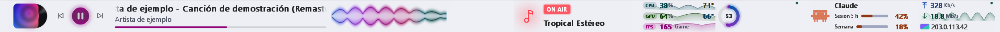

> Las imágenes se generan con datos de ejemplo (`taskbar-panels.exe --render-demo`).

## Paneles

| Panel | En la barra | Al pasar el mouse |
|---|---|---|
| **Multimedia** (si hay algo reproduciéndose o en pausa) | Carátula con vinilo animado, botones anterior / reproducir / siguiente con el color del álbum, título desplazable, progreso y espectro de audio (5 estilos: onda líquida, barras cápsula, LED segmentado, barras con reflejo o línea neón) | Carátula grande, título, artista, álbum, app, tiempos y espectro |
| **Sistema** | CPU y GPU (uso + temperatura; la cifra de CPU es la misma que muestra el Administrador de tareas), FPS de la ventana activa, anillo del disco del sistema (% usado) y un **punto de estado** que pasa a ámbar o rojo cuando algo merece atención | Modelo de CPU, todas las GPU (NVIDIA, AMD Radeon, Intel) y la NPU, frecuencias, ventiladores, VRAM, consumo, RAM, todas las unidades en anillos y E/S de disco con gráficas, **ventiladores animados** que giran según las rpm reales, y **energía**: batería (nivel, animación de carga, vatios, autonomía) y **plan de energía** activo; **avisos** (temperatura alta sostenida, memoria o disco del sistema casi llenos, batería baja) y las **aplicaciones que más consumen** CPU y memoria. Las tarjetas van en dos columnas |
| **Consumo de IA** | El proveedor principal con su icono (o un resumen de todos) | Una tarjeta por proveedor: icono, plan, barras, gasto y reinicios (hora local) |
| **Red** | Subida y bajada con gráficas de 60 s, IP pública con indicador de estado y punto de **salud de la conexión** (verde / ámbar / rojo); en modo icono, **dos anillos** concéntricos (bajada y subida) con la velocidad de bajada debajo | **Salud de la conexión**: diagnóstico en una frase (estable, Wi-Fi inestable, problema del proveedor, DNS lento…) con línea de tiempo de 2 minutos de latencia y pérdidas del router, el DNS e Internet; ISP, ubicación, router con puerta de enlace, DNS, adaptador y **ping a la puerta de enlace** (solo mientras la ventana está abierta), máximos del último minuto, totales de la sesión y **speed test** bajo demanda (Speedtest.net, Cloudflare, LibreSpeed o GCI) y bandera del país de la IP |
| **Radio** | Panel estrecho: nota musical con el letrero **ON AIR** mientras suena y, debajo, el nombre de la emisora como **banner** que se desplaza; en modo icono, una **nota musical roja** con un punto que indica que está al aire | Emisora actual (estado, ciudad y país, formato, tiempo al aire), reproducir / detener y volumen, y, debajo, primero el **país** (todos los de **América** y **Europa**) y después sus emisoras, con **buscador** de países y emisoras, del directorio [Radio Browser](https://www.radio-browser.info); clic en una emisora para escucharla, rueda del mouse o flechas para desplazar la lista. Mientras suena aparece también en el panel multimedia: al detenerla desde aquí ese panel se cierra; en pausa desde el panel multimedia sigue abierto y, si no se reanuda en 1 minuto, la emisora se cierra |

<p>
  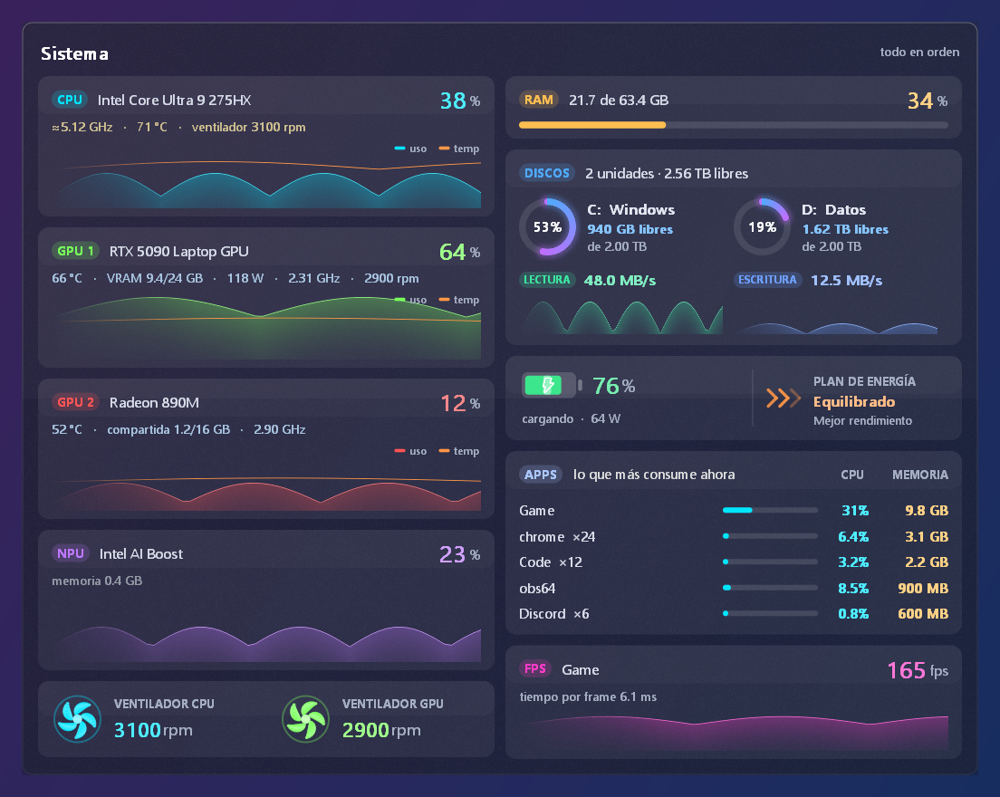
  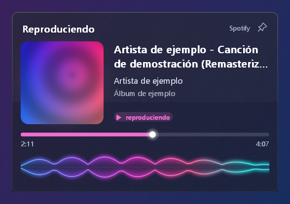
  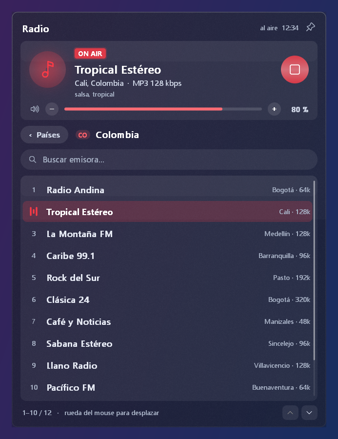
  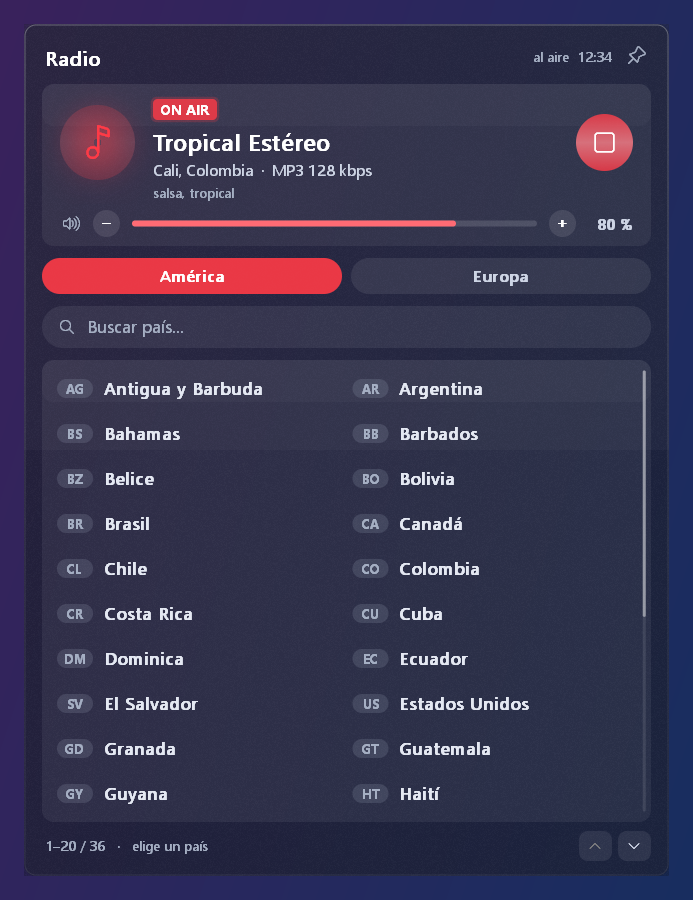
</p>
<p>
  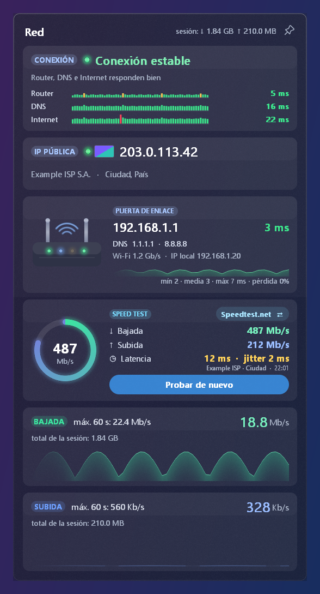
  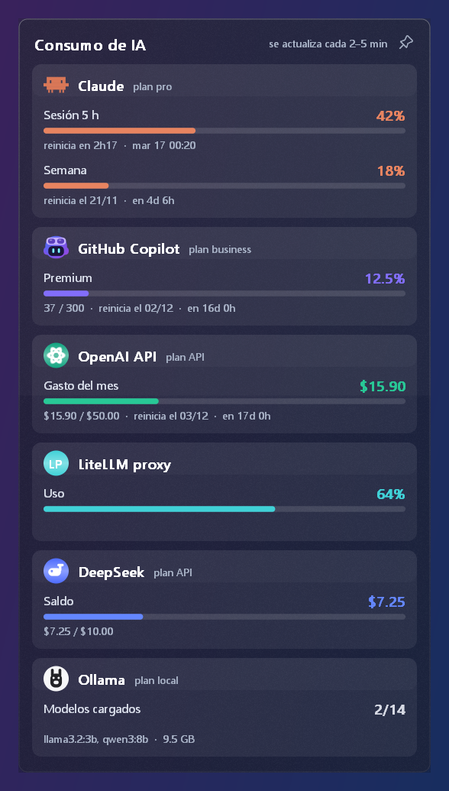
  
</p>

**Modo claro y oscuro:** los paneles y las ventanas siguen el modo de Windows (*Configuración → Personalización → Colores*)
y cambian al instante: en modo claro los textos y gráficas usan la versión oscura de cada color sobre fondo claro.
Cada barra se evalúa por su color real en pantalla, así los paneles siguen legibles aunque Windows deje oscura
una barra secundaria al cambiar de modo.

<p>
  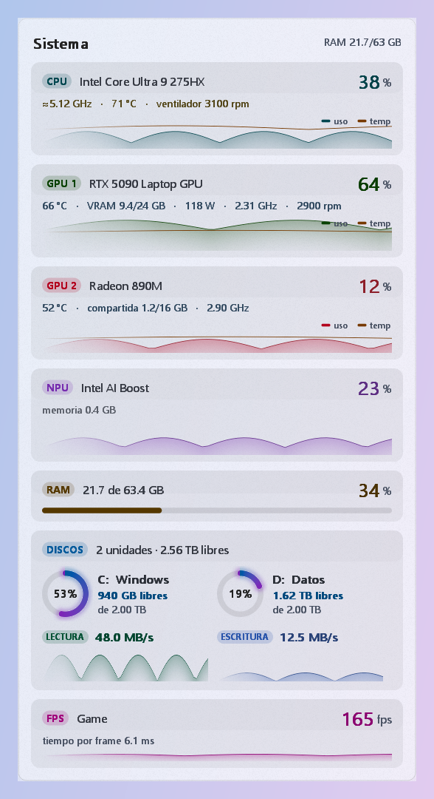
  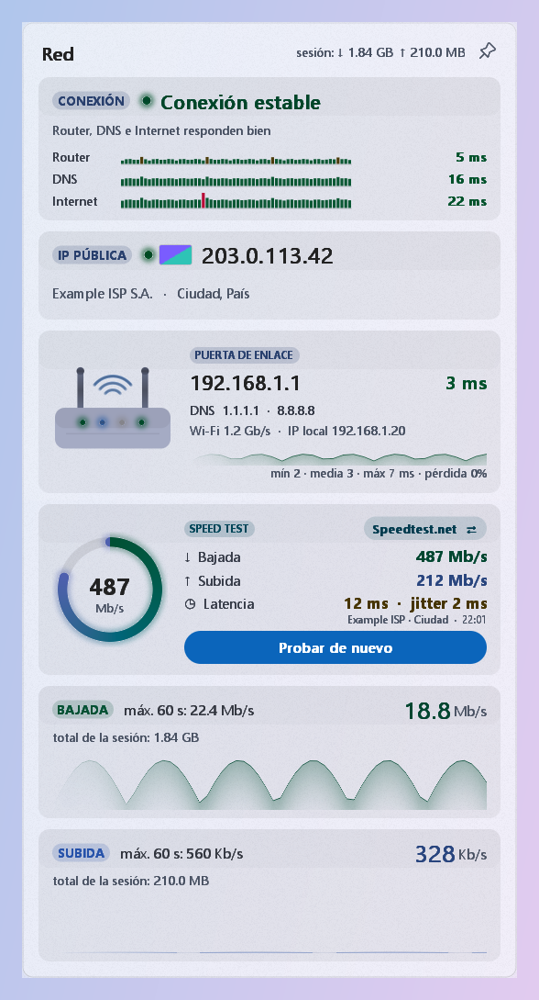
  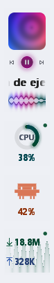
</p>

<p>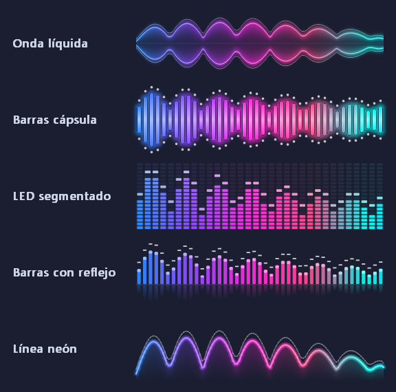</p>

**Se adapta a la barra:** si hay muchas apps abiertas, los paneles de sistema e IA se comprimen a un icono; varias pantallas (todas, solo la principal o una selección por monitor),
barra pequeña o normal, barra arriba, barras verticales (izquierda/derecha, con mods como Windhawk),
iconos centrados o a la izquierda y escala por monitor. Los paneles se ocultan siempre que la barra
no se ve (juegos o videos a pantalla completa, barra auto-ocultada).

## Requisitos

- Windows 11 x64 (Windows 10 puede funcionar, sin garantías).
- Permisos de administrador para instalar: el programa corre con privilegios elevados (tarea
  programada) porque los sensores de temperatura y PresentMon lo necesitan.

Funciones que dependen del equipo (si no están disponibles, el panel muestra «—»):

| Dato | Necesita |
|---|---|
| Uso y memoria de GPU (cualquier GPU y NPU) | Contadores de GPU de Windows 10 1709+ |
| Temperatura, ventilador y frecuencia de GPU | Driver WDDM 2.5+ que los publique (los AMD recientes sí; las Intel integradas no suelen dar temperatura) |
| Consumo de GPU (W) | GPU **NVIDIA** (NVML, incluido en el driver) |
| Temperatura de CPU y velocidad de ventiladores | Portátil **Lenovo Legion/LOQ** (WMI `LENOVO_OTHER_METHOD`) |
| FPS | [PresentMon](https://github.com/GameTechDev/PresentMon) de Intel (el instalador lo descarga) |
| Consumo de Claude | Sesión iniciada en **Claude Code** en ese usuario |
| Consumo de Copilot | Un token de GitHub de la cuenta con Copilot: se detecta solo desde **Git Credential Manager**, **GitHub CLI** (`gh auth login`), los plugins oficiales de Copilot o `GH_TOKEN`; si no, menú **IA → Token de GitHub para Copilot…** |
| Gasto de la API de OpenAI / Anthropic | Una **clave de administrador** de cada plataforma (se pide al agregar el proveedor) |
| Saldo de la cuenta de DeepSeek / Kimi (Moonshot AI) | Una **clave de API** de cada plataforma; con un saldo de referencia opcional (tu última recarga) el saldo se muestra como barra de consumo |
| Modelos disponibles de Gemini y Ollama Cloud | Una **clave de API**; ninguno de los dos publica el consumo ni la cuota restante, así que solo se comprueba la clave y se cuentan los modelos |
| Modelos cargados e instalados de Ollama / LM Studio | El servidor local en marcha (`localhost:11434` / `localhost:1234` por defecto, o cualquier servidor de tu red); sin clave |

## Instalación

### winget (recomendado)

```powershell
winget install sardilac.TaskbarPanels
```

Actualizar: `winget upgrade sardilac.TaskbarPanels` · desinstalar: `winget uninstall sardilac.TaskbarPanels`.

### Instalador

Descarga `TaskbarPanels-Setup-vX.Y.Z-x64.exe` desde [Releases](../../releases) y ejecútalo (pide UAC).
Instalación desatendida: `TaskbarPanels-Setup-vX.Y.Z-x64.exe /VERYSILENT /SUPPRESSMSGBOXES /NORESTART`
(añade `/TASKS=""` para no descargar PresentMon).

El instalador:
- copia el programa a `C:\Program Files\TaskbarPanels`;
- descarga PresentMon del release oficial de Intel y **verifica su firma digital** (tarea opcional);
- registra la tarea programada **TaskbarPanels** (al iniciar sesión, con privilegios elevados, se reinicia
  sola si falla) para el usuario que instala, y arranca los paneles;
- agrega el desinstalador a *Configuración → Aplicaciones*.

### Zip + PowerShell (alternativa)

1. Descarga `TaskbarPanels-vX.Y.Z-x64.zip` desde [Releases](../../releases) y descomprímelo.
2. Abre PowerShell en esa carpeta y ejecuta:

   ```powershell
   powershell -ExecutionPolicy Bypass -File .\install.ps1
   ```

   Hace lo mismo que el instalador (usa `-SkipPresentMon` para omitir PresentMon).

> El ejecutable no está firmado; si SmartScreen lo bloquea, elige *Más información → Ejecutar de todas
> formas* (o marca **Desbloquear** en *Propiedades* del zip antes de descomprimir).

### Desinstalar

Desde *Configuración → Aplicaciones*, con `winget uninstall sardilac.TaskbarPanels` o (instalación con zip):

```powershell
powershell -ExecutionPolicy Bypass -File "C:\Program Files\TaskbarPanels\uninstall.ps1"
# añade -RemoveSettings para borrar también la configuración
```

La configuración (`%APPDATA%\TaskbarPanels`) se conserva al desinstalar.

## Uso

**Clic derecho** sobre cualquier panel (o sobre su icono en la bandeja) abre el menú:

- **Mostrar IP pública**, **Copiar IP**, **Actualizar IP**, **Actualizar consumo**
- **Abrir uso de Claude / Copilot** (páginas web oficiales)
- **Paneles**: activar o desactivar cada panel
- **Pantallas**: todas, solo la principal o una selección de monitores
- **Formato de los paneles**: sistema, IA, red y radio automáticos (icono si no caben, p. ej. con muchas ventanas abiertas), panel o icono. Cada pantalla se calcula con su ancho y escala: los paneles nunca tapan los iconos de las apps y, si como icono no caben en una pantalla, se estrechan y, en último caso, se ocultan en ella los más alejados del reloj hasta que haya sitio
- **Estilo del espectro**: onda líquida, barras cápsula, LED segmentado, barras con reflejo o línea neón
- **IA**: proveedor principal, activar/desactivar proveedores, **agregar** (API de OpenAI, API de Anthropic, Gemini, DeepSeek, Kimi, Ollama local y Cloud, LM Studio, personalizado por URL JSON), quitar y **token de GitHub para Copilot**
- **Fondo de las ventanas**: vidrio esmerilado, cristal transparente, acrílico de Windows, mica u opaco (todos siguen el modo claro/oscuro)
- **Proveedor del speed test**: Speedtest.net, Cloudflare, LibreSpeed o GCI
- **Salud de la conexión**: activa o desactiva la comprobación continua de router / DNS / Internet
- **Idioma / Language**: automático (idioma de Windows), español o inglés
- **Ocultar el cuadro de búsqueda si falta espacio**: cuando en alguna pantalla los paneles no caben ni como iconos entre las apps y el reloj, oculta el cuadro de búsqueda de Windows y lo restaura solo cuando vuelve a haber sitio (también al salir). El ajuste de Windows es común a todas las pantallas
- **Reiniciar posición**, **Salir**

Además: los botones multimedia funcionan sin quitar el foco a la ventana activa, los paneles de red,
IA y sistema se pueden **arrastrar** en horizontal, cada uno por separado, sin solaparse nunca y sin salir de la barra (uno soltado a la izquierda del botón Inicio queda a esa misma distancia del borde izquierdo en todas las pantallas, sea cual sea su ancho), y al **dejar el cursor** sobre un panel aparece su ventana de detalle.

**Widgets de escritorio**: el **pin** de la esquina superior derecha de cada ventana de detalle la fija al escritorio como widget, por debajo de todas las ventanas (se ve cuando el escritorio queda a la vista o con Win+D). Se mueve arrastrándola desde cualquier punto y otro clic en el pin la suelta. Tapado por otras ventanas, un widget no consume nada medible; a la vista, los cinco juntos añaden unos 17 MB y alrededor de un 1 % de un núcleo.

## Configuración

Se guarda en `%APPDATA%\TaskbarPanels\config.json` y se aplica en caliente (≤ 5 s):

| Clave | Valores | Descripción |
|---|---|---|
| `Displays` | `"primary"`, `"all"`, `["SAM7B0C", ...]` | Pantallas donde se muestran los paneles (códigos EDID, ver `MonitorIds`) |
| `PanelDisplays` | `{ "MediaPanel": ["..."] }` | Selección por panel: `NetworkPanel`, `UsagePanel`, `SystemPanel`, `MediaPanel` |
| `Panels` | `{ "SystemPanel": false }` | Activar o desactivar paneles |
| `PanelStyle` | `{ "SystemPanel" / "UsagePanel" / "NetworkPanel" / "RadioPanel": "auto" \| "full" \| "icon" }` | Formato en la barra: panel con detalle o icono (`auto` = icono solo si no cabe; `full` se respeta mientras quepa: si en una pantalla taparía los iconos de las apps, pasa a icono solo en ella). Los iconos miden 34 px lógicos de ancho y los contiguos quedan a 4 px, como los de la bandeja. En barras verticales los tres van como icono salvo que se elija `"full"` |
| `AiProviders` | lista de proveedores | `{ "id", "type": "claude" \| "copilot" \| "openai" \| "anthropic_api" \| "gemini" \| "deepseek" \| "kimi" \| "ollama" \| "ollama_cloud" \| "lmstudio" \| "custom", "name", "enabled", "budget" }`; los personalizados añaden `url`, `percentField`, `valueField`, `labelField`. Las claves van al Administrador de credenciales (`TaskbarPanels:<id>`) |
| `AiPrimary` | `"all"` o un `id` | Proveedor que se muestra en la barra |
| `SpeedTestProvider` | `ookla` (predeterminado) / `cloudflare` / `librespeed` / `gci` | Proveedor del speed test de la ventana de red |
| `IpShowAddress` | `true` / `false` | Mostrar la IP pública en el panel de red |
| `AutoSearchBox` | `false` (predeterminado), `true` / `"hide"`, `"icon"` | Recoger el cuadro de búsqueda de Windows cuando los paneles no caben ni como iconos (ocultarlo o dejarlo en icono) y restaurarlo al liberarse espacio |
| `NetHealth` | `true` (predeterminado) / `false` | Salud de la conexión: ping al router, al DNS y a Internet cada 2 s (menú *Salud de la conexión*) |
| `SpectrumStyle` | `"wave"`, `"bars"`, `"led"`, `"mirror"`, `"line"` | Estilo del espectro de audio (panel y ventana) |
| `MediaWidth` | `400`, `480`, `560` (predeterminado), `680`, `800` o cualquier valor de 320 a 1200 | Ancho del panel multimedia en píxeles lógicos (menú *Tamaño del panel multimedia*); se reduce solo si no hay espacio suficiente (sin espectro por debajo de 300 px, solo carátula y botones hasta 160 px) |
| `Language` | `"auto"`, `"es"`, `"en"` | Idioma de la interfaz (por defecto, el de Windows: español o, si no, inglés) |
| `PopupStyle` | `"glass"`, `"clear"`, `"acrylic"`, `"mica"`, `"dark"` | Fondo de las ventanas flotantes (`"dark"` = opaco, sigue el modo claro/oscuro) |
| `DeskWidget` | `{ "SystemPanel": { "X": 100, "Y": 80 } }` | Ventanas fijadas al escritorio como widget y su posición en píxeles físicos de pantalla (`SystemPanel`, `NetworkPanel`, `UsagePanel`, `MediaPanel`, `RadioPanel`); se gestiona con el pin de cada ventana |
| `SecondaryRightMargin` | número (px lógicos) | Espacio reservado al reloj en barras secundarias mientras no se conoce su tamaño real (se mide en cada pantalla) |
| `MonitorIds` | (informativo) | Código → nombre de los monitores detectados |

Otros archivos en la misma carpeta: `pos.json` (posición de cada panel arrastrable: `Offsets` desde el borde derecho y `Left` desde el izquierdo para los soltados a la izquierda de Inicio), `ai_cache.json`
(último consumo, evita consultas al reiniciar), `flags\` (caché de banderas), `crash.log` (si el programa falla)
y `debug.log` (solo si existe `debug.flag`).

## Compilar desde el código

Requiere [Rust](https://rustup.rs) (toolchain `stable-x86_64-pc-windows-msvc`) y las
*Build Tools* de Visual Studio con el componente de C++. El instalador necesita además [Inno Setup 6](https://jrsoftware.org/isinfo.php).

```powershell
cargo build --release
.\scripts\install.ps1                 # instala lo recién compilado
.\scripts\make-screenshots.ps1        # regenera docs/images con datos de ejemplo
.\scripts\package.ps1                 # genera dist\TaskbarPanels-vX.Y.Z-x64.zip y el instalador Setup .exe (+ .sha256)
```

Estructura:

```
src/
  main.rs     ventanas, dibujo de los paneles, menús y ventanas flotantes
  render.rs   lienzo con alfa por píxel (UpdateLayeredWindow), formas y texto suavizados
  host.rs     barras de tareas (los paneles son ventanas hijas de la barra), monitores, orientación, pantalla completa (Win32 + UI Automation)
  state.rs    estado compartido e IP pública
  ai.rs       proveedores de IA (Claude, Copilot, OpenAI, Anthropic, Gemini, DeepSeek, Kimi, Ollama, LM Studio, personalizados) y credenciales
  speedtest.rs prueba de velocidad (latencia, bajada y subida): Speedtest.net, Cloudflare, LibreSpeed o GCI
  flags.rs    bandera del país de la IP pública (flagcdn.com, con caché local)
  net.rs      red local: adaptador, puerta de enlace, DNS (GetAdaptersAddresses) y ping (IcmpSendEcho); salud de la conexión (sondeo por tramos y diagnóstico)
  gpu.rs      todas las GPU y NPU: DXGI/DXCore, contadores de GPU de Windows, D3DKMT, NVML
  sys.rs      CPU/disco (PDH), GPU/NPU con gpu.rs, sensores Lenovo (WMI), FPS (PresentMon), RAM, unidades, batería, plan de energía y consumo por aplicación
  media.rs    sesión multimedia (WinRT), carátula, línea de tiempo y espectro (WASAPI + FFT)
  i18n.rs     idioma de la interfaz (español / inglés según Windows)
  config.rs   config.json
installer/    script de Inno Setup (TaskbarPanels.iss)
scripts/      install / uninstall / installer-helper / package / make-screenshots
```

## Publicar un release

El workflow `.github/workflows/release.yml` compila, empaqueta y publica el release al subir un tag;
después, su job `winget` abre el pull request de actualización en `microsoft/winget-pkgs` (`winget.yml` permite repetirlo a mano).

```powershell
# 1. sube la versión en Cargo.toml y anota los cambios en CHANGELOG.md / CHANGELOG.es.md
git commit -am "v1.0.1"
git tag v1.0.1
git push origin main --tags
```

El release incluye `TaskbarPanels-Setup-vX.Y.Z-x64.exe`, `TaskbarPanels-vX.Y.Z-x64.zip` y sus `.sha256`.
El workflow de winget necesita el secreto `WINGET_TOKEN` (PAT clásico con el permiso `public_repo`)
y un fork de `microsoft/winget-pkgs` en la misma cuenta.

## Privacidad y notas

- Todo se procesa localmente. Las únicas conexiones de red son:
  - `ifconfig.co` (y `api.ipify.org` de respaldo) para la IP pública, cada 5 min;
  - `api.anthropic.com/api/oauth/usage` con el token de Claude Code, cada 3 min;
  - `api.github.com/copilot_internal/user` con tu token de GitHub, cada 5 min;
  - si los agregas: `api.openai.com/v1/organization/costs`, `api.anthropic.com/v1/organizations/cost_report` `generativelanguage.googleapis.com/v1beta/models`, `api.deepseek.com/user/balance`, `api.moonshot.ai/v1/users/me/balance`, `ollama.com/api/ps` y `/api/tags` (cada 5 min), tu servidor de Ollama / LM Studio (cada 30 s) y las URL de tus proveedores personalizados (cada 2 min);
  - `api.github.com` / `github.com` solo durante la instalación, para descargar PresentMon;
  - ping ICMP a la **puerta de enlace local**, solo mientras la ventana de red está abierta;
  - salud de la conexión: un ping ICMP cada 2 s a la puerta de enlace local, a tu servidor DNS y a `1.1.1.1` (`8.8.8.8` si no responde); se puede desactivar desde el menú (*Salud de la conexión*) o con `"NetHealth": false`;
  - `www.cloudflare.com/cdn-cgi/trace` junto con la consulta de IP, para confirmar el país;
  - `flagcdn.com` para la bandera del país de la IP, una sola vez por país (queda en caché);
  - el proveedor de speed test elegido (`speed.cloudflare.com`, servidores de Speedtest.net vía `www.speedtest.net/api/js/servers`, servidores públicos de LibreSpeed vía `librespeed.org/backend-servers` o `speedtest.gci.co.cr`), solo al pulsar **Iniciar prueba** en la ventana de red (8 s de bajada y 8 s de subida; los datos usados dependen de la velocidad: unos 150 MB con 100 Mb/s simétricos, cerca de 1,5 GB con 1 Gb/s).
- Los endpoints de consumo de Claude y Copilot **no están documentados**: pueden cambiar sin aviso.
  Si responden con error o límite de consultas (429), se conservan los últimos valores.
- El programa **no renueva** el token de Claude Code: si caduca, se renueva al volver a abrir Claude Code.

## Solución de problemas

| Problema | Qué hacer |
|---|---|
| No aparecen los paneles | Comprueba la tarea: `Get-ScheduledTask TaskbarPanels`; revisa `%APPDATA%\TaskbarPanels\crash.log` |
| Faltan en una pantalla | Menú **Pantallas**; se ocultan a propósito cuando la barra no se ve (pantalla completa, auto-ocultar) |
| FPS siempre «—» | ¿Existe `C:\Program Files\TaskbarPanels\tools\PresentMon.exe`? Reinstala con la tarea de PresentMon |
| Temperatura de CPU «—» | Solo disponible en portátiles Lenovo compatibles |
| Consumo de Claude «—» | Abre Claude Code para renovar la sesión; espera hasta 3 min |
| Copilot «sin credenciales» | No se encontró un token de GitHub: ejecuta `gh auth login` o usa el menú **IA → Token de GitHub para Copilot…** |
| Copilot «sin acceso a Copilot» | El token es de otra cuenta o sin Copilot: guarda el de la cuenta correcta en **IA → Token de GitHub para Copilot…** |
| Diagnóstico detallado | Crea `%APPDATA%\TaskbarPanels\debug.flag` y revisa `debug.log` |

## Licencia

[MIT](LICENSE). PresentMon es © Intel Corporation (licencia MIT) y se descarga de su repositorio oficial.
