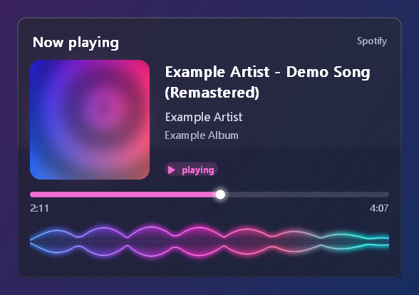
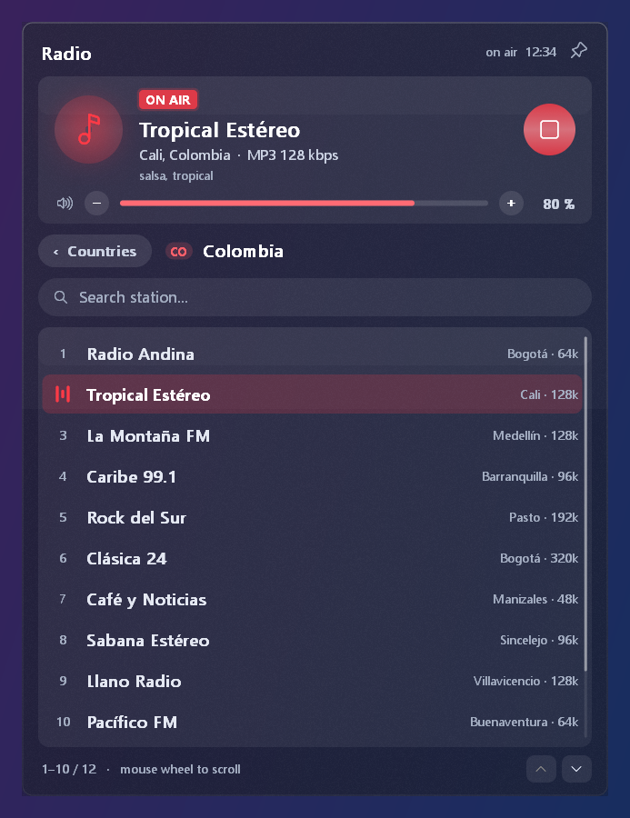
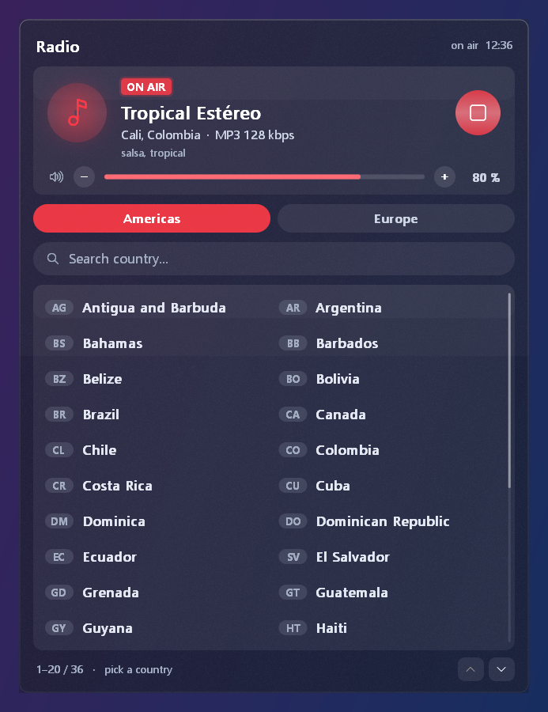
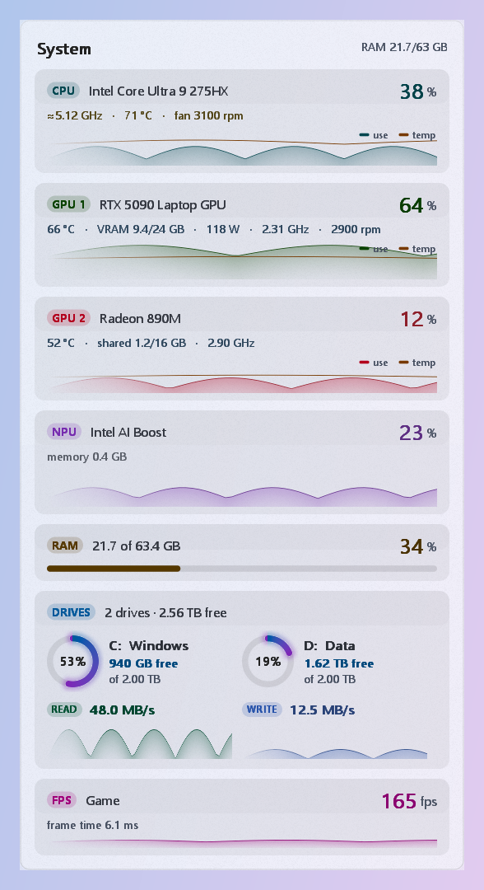
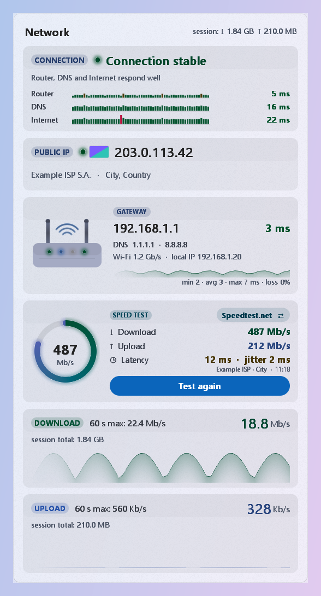
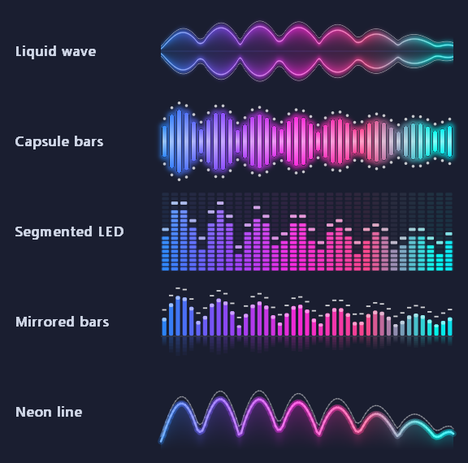

# Taskbar Panels

**English** · [Español](README.es.md)

Modern, lightweight panels for the **Windows 11** taskbar, written in **Rust**:
network, AI usage (Claude / GitHub Copilot / OpenAI / Anthropic / Gemini / DeepSeek / Kimi / Ollama / LM Studio), system (CPU, GPU, FPS, disks), media and Internet radio.
Real transparency, 60 fps animations and frosted-glass flyouts with the details of each panel,
all in a single process using ~5–10 MB of private memory and less than 1 % of one core.


> Images are generated with sample data (`taskbar-panels.exe --render-demo`); the interface
> follows the Windows language (Spanish or English).

## Panels

| Panel | On the taskbar | On hover |
|---|---|---|
| **Media** (while something is playing or paused) | Album art with an animated vinyl, previous / play / next buttons tinted with the album color, scrolling title, progress and audio spectrum (5 styles: liquid wave, capsule bars, segmented LED, mirrored bars or neon line) | Large album art, title, artist, album, app, times and spectrum |
| **System** | CPU and GPU (usage + temperature; the CPU figure is the same one Task Manager shows), FPS of the active window, system-drive ring (% used) and a **status dot** that turns amber or red when something needs attention | CPU model, every GPU (NVIDIA, AMD Radeon, Intel) and the NPU, clocks, fans, VRAM, power, RAM, every drive as a ring and disk I/O charts, **animated fans** that spin with the real rpm, and **power**: battery (level, charging animation, watts, time left) and the active **power plan**; **alerts** (sustained high temperature, memory or system drive almost full, low battery) and the **apps using the most** CPU and memory. Cards are laid out in two columns |
| **AI usage** | The primary provider with its icon (or a summary of all of them) | One card per provider: icon, plan, bars, spend and resets (local time) |
| **Network** | Upload and download with 60 s charts, public IP with status indicator and a **connection health** dot (green / amber / red); in icon mode, **two concentric rings** (download and upload) with the download speed below | **Connection health**: a one-line diagnosis (stable, unstable Wi-Fi, provider issue, slow DNS…) with a 2-minute latency and loss timeline for router, DNS and Internet; ISP, location, **country flag** of the IP, router with gateway, DNS, adapter and **gateway ping** (only while the flyout is open), last-minute peaks, session totals and an on-demand **speed test** (Speedtest.net, Cloudflare, LibreSpeed or GCI) |
| **Radio** | Narrow panel: musical note with an **ON AIR** sign while it plays and, below it, the station name as a scrolling **banner**; in icon mode, a **red musical note** with a dot showing it is on air | Current station (status, city and country, format, time on air), play / stop and volume, and, below, first the **country** (all of the **Americas** and **Europe**) and then its stations, with a **search box** for countries and stations, from the [Radio Browser](https://www.radio-browser.info) directory; click a station to listen, mouse wheel or arrows to scroll the list |

<p>
  
  
  
  
</p>
<p>
  
  
  
</p>

**Light and dark mode:** panels and flyouts follow the Windows mode (*Settings → Personalization → Colors*)
and switch on the fly: in light mode text and charts use the dark version of each color over a light background.
Each taskbar is checked by its actual on-screen color, so panels stay readable even when Windows leaves a
secondary taskbar dark after switching modes.

<p>
  
  
  
</p>

<p></p>

**Adapts to the taskbar:** with many apps open, the system and AI panels shrink to an icon; multiple
displays (all, primary only or a per-monitor selection), small or normal taskbar, top taskbar, vertical
taskbars (left/right, with mods such as Windhawk), centered or left-aligned icons and per-monitor scaling.
Panels hide whenever the taskbar is not visible (full-screen games or videos, auto-hide).

## Requirements

- Windows 11 x64 (Windows 10 may work, no guarantees).
- Administrator rights to install: the program runs elevated (scheduled task) because the
  temperature sensors and PresentMon require it.

Hardware-dependent features (when unavailable, the panel shows "—"):

| Data | Requires |
|---|---|
| GPU usage and memory (any GPU and NPU) | Windows 10 1709+ GPU counters |
| GPU temperature, fan and clock | WDDM 2.5+ driver that reports them (recent AMD drivers do; Intel iGPUs usually report no temperature) |
| GPU power (W) | **NVIDIA** GPU (NVML, included with the driver) |
| CPU temperature and fan speed | **Lenovo Legion/LOQ** laptop (WMI `LENOVO_OTHER_METHOD`) |
| FPS | Intel [PresentMon](https://github.com/GameTechDev/PresentMon) (the installer downloads it) |
| Claude usage | Signed in to **Claude Code** for that user |
| Copilot usage | A GitHub token of the account with Copilot: detected automatically from **Git Credential Manager**, **GitHub CLI** (`gh auth login`), the official Copilot plugins or `GH_TOKEN`; otherwise, **AI → GitHub token for Copilot…** menu |
| OpenAI / Anthropic API spend | An **admin key** for each platform (asked for when adding the provider) |
| DeepSeek / Kimi (Moonshot AI) account balance | An **API key** for each platform; an optional reference balance (your last top-up) turns the balance into a usage bar |
| Gemini and Ollama Cloud available models | An **API key**; neither service publishes usage or remaining quota, so only the key is checked and the models are counted |
| Ollama / LM Studio loaded and installed models | The local server running (`localhost:11434` / `localhost:1234` by default, or any server on your network); no key needed |

## Installation

### winget (recommended)

```powershell
winget install sardilac.TaskbarPanels
```

Updates: `winget upgrade sardilac.TaskbarPanels` · uninstall: `winget uninstall sardilac.TaskbarPanels`.

### Installer

Download `TaskbarPanels-Setup-vX.Y.Z-x64.exe` from [Releases](../../releases) and run it (it asks for UAC).
Unattended install: `TaskbarPanels-Setup-vX.Y.Z-x64.exe /VERYSILENT /SUPPRESSMSGBOXES /NORESTART`
(add `/TASKS=""` to skip downloading PresentMon).

The installer:
- copies the program to `C:\Program Files\TaskbarPanels`;
- downloads PresentMon from Intel's official release and **verifies its digital signature** (optional task);
- registers the **TaskbarPanels** scheduled task (at logon, elevated, restarts itself on failure)
  for the user who installs it, and starts the panels;
- adds the uninstaller to *Settings → Apps*.

### Zip + PowerShell (alternative)

1. Download `TaskbarPanels-vX.Y.Z-x64.zip` from [Releases](../../releases) and extract it.
2. Open PowerShell in that folder and run:

   ```powershell
   powershell -ExecutionPolicy Bypass -File .\install.ps1
   ```

   It does the same as the installer (use `-SkipPresentMon` to skip PresentMon).

> The executable is not code-signed; if SmartScreen blocks it, choose *More info → Run anyway*
> (or tick **Unblock** in the zip's *Properties* before extracting).

### Uninstall

From *Settings → Apps*, with `winget uninstall sardilac.TaskbarPanels`, or (zip install):

```powershell
powershell -ExecutionPolicy Bypass -File "C:\Program Files\TaskbarPanels\uninstall.ps1"
# add -RemoveSettings to also delete the settings
```

Settings (`%APPDATA%\TaskbarPanels`) are kept when uninstalling.

## Usage

**Right-click** any panel (or its tray icon) to open the menu:

- **Show public IP**, **Copy IP**, **Refresh IP**, **Refresh usage**
- **Open Claude / Copilot usage** (official web pages)
- **Panels**: enable or disable each panel
- **Displays**: all, primary only or a selection of monitors
- **Panel format**: system, AI, network and radio automatic (icon if they do not fit, e.g. with many open windows), panel or icon
- **Spectrum style**: liquid wave, capsule bars, segmented LED, mirrored bars or neon line
- **AI**: primary provider, enable/disable providers, **add** (OpenAI API, Anthropic API, Gemini, DeepSeek, Kimi, Ollama local and Cloud, LM Studio, custom JSON URL), remove and **GitHub token for Copilot**
- **Window background**: frosted glass, clear glass, Windows acrylic, mica or solid (all follow light/dark mode)
- **Speed test provider**: Speedtest.net, Cloudflare, LibreSpeed or GCI
- **Connection health**: turn the continuous router / DNS / Internet check on or off
- **Idioma / Language**: automatic (Windows language), Spanish or English
- **Reset position**, **Exit**

Also: the media buttons work without stealing focus from the active window, the network, AI and
system panels can each be **dragged** horizontally on their own (they never overlap or leave the bar), and **hovering** over a panel opens its detail flyout. In the
network flyout, the speed-test card has a provider selector (click to switch) and a **Start test** button.

## Settings

Stored in `%APPDATA%\TaskbarPanels\config.json` and applied live (≤ 5 s):

| Key | Values | Description |
|---|---|---|
| `Displays` | `"primary"`, `"all"`, `["SAM7B0C", ...]` | Displays where the panels are shown (EDID codes, see `MonitorIds`) |
| `PanelDisplays` | `{ "MediaPanel": ["..."] }` | Per-panel selection: `NetworkPanel`, `UsagePanel`, `SystemPanel`, `MediaPanel` |
| `Panels` | `{ "SystemPanel": false }` | Enable or disable panels |
| `PanelStyle` | `{ "SystemPanel" / "UsagePanel" / "NetworkPanel" / "RadioPanel": "auto" \| "full" \| "icon" }` | Taskbar format: detailed panel or icon (`auto` = icon only if it does not fit). On vertical taskbars the three are icons unless set to `"full"` |
| `AiProviders` | list of providers | `{ "id", "type": "claude" \| "copilot" \| "openai" \| "anthropic_api" \| "gemini" \| "deepseek" \| "kimi" \| "ollama" \| "ollama_cloud" \| "lmstudio" \| "custom", "name", "enabled", "budget" }`; custom ones add `url`, `percentField`, `valueField`, `labelField`. Keys go to Windows Credential Manager (`TaskbarPanels:<id>`) |
| `AiPrimary` | `"all"` or an `id` | Provider shown on the taskbar |
| `SpeedTestProvider` | `ookla` (default) / `cloudflare` / `librespeed` / `gci` | Speed-test provider of the network flyout |
| `IpShowAddress` | `true` / `false` | Show the public IP on the network panel |
| `NetHealth` | `true` (default) / `false` | Connection health: pings the router, DNS and Internet every 2 s (*Connection health* menu) |
| `SpectrumStyle` | `"wave"`, `"bars"`, `"led"`, `"mirror"`, `"line"` | Audio spectrum style (panel and flyout) |
| `MediaWidth` | `400`, `480`, `560` (default), `680`, `800` or any value from 320 to 1200 | Media panel width in logical pixels (*Media panel size* menu); it shrinks automatically if there is not enough room |
| `Language` | `"auto"`, `"es"`, `"en"` | Interface language (default: the Windows language; Spanish, otherwise English) |
| `PopupStyle` | `"glass"`, `"clear"`, `"acrylic"`, `"mica"`, `"dark"` | Flyout background (`"dark"` = solid, follows light/dark mode) |
| `SecondaryRightMargin` | number (logical px) | Space reserved for the clock on secondary taskbars |
| `MonitorIds` | (informational) | Code → name of the detected monitors |

Other files in the same folder: `pos.json` (network panel offset), `ai_cache.json` (last usage,
avoids queries on restart), `flags\` (country flags cache), `crash.log` (if the program crashes)
and `debug.log` (only if `debug.flag` exists).

## Building from source

Requires [Rust](https://rustup.rs) (`stable-x86_64-pc-windows-msvc` toolchain) and the Visual Studio
*Build Tools* with the C++ component. The installer additionally needs [Inno Setup 6](https://jrsoftware.org/isinfo.php).

```powershell
cargo build --release
.\scripts\install.ps1                 # installs what was just built
.\scripts\make-screenshots.ps1        # regenerates docs/images with sample data
.\scripts\package.ps1                 # builds dist\TaskbarPanels-vX.Y.Z-x64.zip and the Setup .exe (+ .sha256)
```

Layout:

```
src/
  main.rs      windows, panel drawing, menus and flyouts
  render.rs    per-pixel alpha canvas (UpdateLayeredWindow), anti-aliased shapes and text
  host.rs      taskbars (panels are child windows of the taskbar), monitors, orientation, taskbar visibility (Win32 + UI Automation)
  state.rs     shared state and public IP (country confirmed with Cloudflare)
  ai.rs        AI providers (Claude, Copilot, OpenAI, Anthropic, Gemini, DeepSeek, Kimi, Ollama, LM Studio, custom) and credentials
  speedtest.rs speed test (latency, download, upload): Speedtest.net, Cloudflare, LibreSpeed or GCI
  flags.rs     country flag of the public IP (flagcdn.com, cached locally)
  net.rs       local network: adapter, gateway, DNS (GetAdaptersAddresses) and ping (IcmpSendEcho); connection health (per-hop probing and diagnosis)
  gpu.rs       every GPU and NPU: DXGI/DXCore, Windows GPU counters, D3DKMT, NVML
  sys.rs       CPU/disk (PDH), GPU/NPU via gpu.rs, Lenovo sensors (WMI), FPS (PresentMon), RAM, drives, battery, power plan and per-app usage
  media.rs     media session (WinRT), album art, timeline and spectrum (WASAPI + FFT)
  i18n.rs      interface language (Spanish / English following Windows)
  config.rs    config.json
installer/     Inno Setup script (TaskbarPanels.iss)
scripts/       install / uninstall / installer-helper / package / make-screenshots
```

## Publishing a release

`.github/workflows/release.yml` builds, packages and publishes the release when a tag is pushed;
its `winget` job then opens the update pull request in `microsoft/winget-pkgs` (`winget.yml` lets you re-run it manually).

```powershell
# 1. bump the version in Cargo.toml and add the changes to CHANGELOG.md / CHANGELOG.es.md
git commit -am "v1.3.1"
git tag v1.3.1
git push origin main --tags
```

The release contains `TaskbarPanels-Setup-vX.Y.Z-x64.exe`, `TaskbarPanels-vX.Y.Z-x64.zip` and their `.sha256`.
The winget workflow needs a `WINGET_TOKEN` secret (a classic PAT with the `public_repo` scope)
and a fork of `microsoft/winget-pkgs` in the same account.

## Privacy and notes

- Everything is processed locally. The only network connections are:
  - `ifconfig.co` (and `api.ipify.org` as a fallback) for the public IP, every 5 min;
  - `www.cloudflare.com/cdn-cgi/trace` along with the IP query, to confirm the country;
  - `flagcdn.com` for the country flag, once per country (then cached);
  - `api.anthropic.com/api/oauth/usage` with the Claude Code token, every 3 min;
  - `api.github.com/copilot_internal/user` with your GitHub token, every 5 min;
  - if you add them: `api.openai.com/v1/organization/costs`, `api.anthropic.com/v1/organizations/cost_report` `generativelanguage.googleapis.com/v1beta/models`, `api.deepseek.com/user/balance`, `api.moonshot.ai/v1/users/me/balance`, `ollama.com/api/ps` and `/api/tags` (every 5 min), your Ollama / LM Studio server (every 30 s) and the URLs of your custom providers (every 2 min);
  - `api.github.com` / `github.com` only during installation, to download PresentMon;
  - ICMP ping to the **local gateway**, only while the network flyout is open;
  - connection health: one ICMP ping every 2 s to the local gateway, to your DNS server and to `1.1.1.1` (`8.8.8.8` if it does not reply); it can be turned off from the menu (*Connection health*) or with `"NetHealth": false`;
  - the chosen speed-test provider (`speed.cloudflare.com`, Speedtest.net servers via `www.speedtest.net/api/js/servers`, public LibreSpeed servers via `librespeed.org/backend-servers` or `speedtest.gci.co.cr`), only when you press **Start test** in the network flyout (8 s of download and 8 s of upload; data use grows with speed: about 150 MB on a symmetric 100 Mb/s line, close to 1.5 GB on 1 Gb/s).
- The Claude and Copilot usage endpoints are **undocumented**: they may change without notice.
  If they return an error or a rate limit (429), the last values are kept.
- The program **does not refresh** the Claude Code token: if it expires, it is renewed the next time you open Claude Code.

## Troubleshooting

| Problem | What to do |
|---|---|
| Panels do not appear | Check the task: `Get-ScheduledTask TaskbarPanels`; look at `%APPDATA%\TaskbarPanels\crash.log` |
| Missing on a display | **Displays** menu; they hide on purpose when the taskbar is hidden (full screen, auto-hide) |
| FPS always "—" | Does `C:\Program Files\TaskbarPanels\tools\PresentMon.exe` exist? Reinstall with the PresentMon task |
| CPU temperature "—" | Only available on supported Lenovo laptops |
| Claude usage "—" | Open Claude Code to renew the session; wait up to 3 min |
| Copilot "no credentials" | No GitHub token was found: run `gh auth login` or use **AI → GitHub token for Copilot…** |
| Copilot "no Copilot access" | The token belongs to another account or has no Copilot: save the right one in **AI → GitHub token for Copilot…** |
| Detailed diagnostics | Create `%APPDATA%\TaskbarPanels\debug.flag` and check `debug.log` |

## License

[MIT](LICENSE). PresentMon is © Intel Corporation (MIT license) and is downloaded from its official repository.
